# claude-errands

A Claude Code plugin that hands a written brief to a live Codex session, waits for that turn to end, and reports how it ended. Claude plans and reviews. Codex does the work in its own session, where you see it and answer its approvals. For one-shot headless Codex tasks, use the `codex` plugin instead.

[Quick start](#quick-start) · [What it writes](#what-it-writes-and-what-it-never-does) · [Reference](docs/REFERENCE.md) · [Architecture](docs/ARCHITECTURE.md) · [Testing](TESTING.md)

## Quick start

You need macOS, git, Node 25 or newer on the `PATH` Claude Code starts with, and codex-cli 0.163.0.

1. Install the plugin in Claude Code:

   ```
   /plugin marketplace add hex/claude-marketplace
   /plugin install claude-errands
   ```

2. Start `codex` in the folder Claude Code runs in, or in a folder below it, and leave it open.

3. Within 15 seconds a line shows up at the right end of Claude's prompt footer:

   ```
   Codex 01a1b2c3 (.) idle  [ ↗ Work with Codex ]
   ```

   Click **↗ Work with Codex**, or ask Claude to hand a task to Codex. The footer takes no keyboard focus, so from the keyboard run `/claude-errands:work-with-codex [task]`. It does what the button does, with the task after the command instead of in the prompt.

## What happens next

Claude plans how to split the work: what goes to Codex, what Claude keeps, and what can run at the same time. It shows you the plan and asks before sending anything. If you typed something in the prompt before pressing the button, that is the task. If the work is too small to split, Claude says so.

Each part that goes to Codex becomes a brief: the worktree and branch to work in, the paths Codex may change, the test command, and the work. A brief can also ask Codex to create a fresh worktree for the job. Claude shows you each brief, sends it, and waits in the background.

While Codex works, the line in the prompt footer shows a spinner and how long the turn has run, such as `Codex ⠋ 01a1b2c3 (.) working 2m14s`, or `needs approval` when Codex waits on you in its own pane. When a Codex session starts waiting on you, Claude Code also sends a notification through your terminal, or shows a toast when it cannot. When the turn ends, Claude gets the outcome and reviews the work. From a test run:

```text
Job: errand-d6d4ad13-1a34-45a4-9242-d20cfc77e305
Outcome: done
Final answer:
Created `src/7e2f1224.txt` containing `7e2f1224` and committed as `1834ba1` with message `add 7e2f1224`. Test command passed. Nothing pushed.

RESULT: done
Commits:
  1834ba1 add 7e2f1224
Outside allow-list:
  none
Modified before this job:
  none
Uncommitted changes: no
```

The outcome is `done`, `question` or `declined` when Codex says so on the last line of its answer. `done` is Codex's claim, so Claude still reviews the commits. Every command, outcome and brief rule is in the [reference](docs/REFERENCE.md).

## Examples

1. With Codex open in this folder or below it, ask Claude:

   ```text
   Add a --json flag to targets and cover it with tests.
   ```

   Claude offers a choice before starting implementation: hand the task to the named Codex session or do it here. Choosing Codex approves the handoff. Claude shows you the brief and sends it in the same turn.

2. Type this draft in the prompt box without submitting it:

   ```text
   Add a --name filter to targets and cover it with tests.
   ```

   Click **↗ Work with Codex** in the prompt footer. Claude shows a split plan and asks whether to send it as planned, change the split, or do it all here. The draft clears when the prompt goes through. Nothing goes to Codex until you answer.

3. Run the command with a task:

   ```text
   /claude-errands:work-with-codex add a --status filter to targets with tests
   ```

   With Codex open, Claude shows the same split plan and choices as the button. If the task is too small to split, Claude says so.

## What it writes and what it never does

- It keeps its job records, a copy of each brief, the thread each Claude session sends to, and worktree locks under `${XDG_STATE_HOME:-~/.local/state}/claude-errands/`.
- It writes nothing into your repositories. Codex makes the changes, in the worktree the brief names.
- The plugin contacts no network service itself. It talks to the Codex daemon over its local socket. The brief and the code Codex reads then go to OpenAI through your Codex account, as with any Codex turn.
- In every Claude Code session that loads it, it runs `node`, `ps` and `lsof` every 5 to 60 seconds to look for Codex sessions in that folder.
- When Codex sessions open or close, Claude Code adds a plain text note beside your next message with each thread id and folder.
- The plugin tells Claude to ask you before it hands implementation work to Codex, and to show you every brief before it sends one.
- It never sends a job twice and never stops a Codex turn. `abandon` only frees the worktree for another job.

For an open session, the full note is below. `<thread id>` and `<folder>` stand for that session's id and folder. Each open session gets its own line.

```text
Live Codex sessions are open inside your working directory:
- thread <thread id>, cwd "<folder>"
The person keeps these Codex sessions open to split the work with you. When work goes to Codex, you plan, write briefs and review, and Codex writes the code.
Before starting implementation work, ask the person once per task with AskUserQuestion whether to hand it to Codex or do it here, with Codex as the first option and naming the session it would go to. Do not ask when the person already said where the work goes, or for questions, reviews and one-line fixes, which you handle here. Any other change to the code counts as implementation work, however small it looks.
When the person picks Codex, write the brief with the claude-errands:brief skill and send it with the claude-errands:send skill, passing --target <thread id> on every send.
Show the person each brief, then send it in the same turn without asking again: choosing Codex is the approval. Never edit a worktree while a Codex job holds it: claude-errands reports every change there as the agent's.
```

## Troubleshooting

- No Codex line in the footer: leave a Codex session open in Claude Code's project folder or below it. A new session shows within 15 seconds.
- A closed session stays listed. Codex unloads its thread after minutes. The line stays until then.
- `Codex check failed: <reason>`: the footer shows the check's error. Make sure `node` is on the `PATH` Claude Code started with. The command `/claude-errands:work-with-codex` gives the reason up to 200 characters.
- `needs approval`: answer the approval in the Codex pane.
- A change to the plugin does not take effect: run `/reload-plugins` in Claude Code.

## Support

Report issues at [GitHub Issues](https://github.com/hex/claude-errands/issues) or email [support@hexul.com](mailto:support@hexul.com). Report vulnerabilities privately through [SECURITY.md](SECURITY.md).

## More

- [docs/REFERENCE.md](docs/REFERENCE.md): every command, outcome, brief rule, file and limit.
- [docs/ARCHITECTURE.md](docs/ARCHITECTURE.md): how it works and the Codex daemon facts it depends on.
- [TESTING.md](TESTING.md): the test suites, working on the plugin, and releasing.

A second transport for Google's `agy`, through its `Stop` lifecycle hook, does not exist yet. See "Second transport: agy" in [docs/ARCHITECTURE.md](docs/ARCHITECTURE.md#second-transport-agy).

## License

MIT. See [LICENSE](LICENSE).
