# claude-errands

A Claude Code plugin that hands a written brief to a live Codex session, waits for that turn to end, and reports how it ended. Claude plans and reviews. Codex does the work in its own session, where you see it and answer its approvals. For one-shot headless Codex tasks, use the `codex` plugin instead.

[Quick start](#quick-start) · [What it writes](#what-it-writes-and-what-it-never-does) · [Reference](docs/REFERENCE.md) · [Architecture](docs/ARCHITECTURE.md) · [Testing](TESTING.md)

## Quick start

You need macOS, git, Node 25 or newer on the `PATH` Claude Code starts with, and codex-cli 0.163.0.

1. Install the plugin in Claude Code:

   ```
   /plugin marketplace add hex/claude-marketplace
   /plugin install claude-errands
   ```

2. Start `codex` in the folder Claude Code runs in, or in a folder below it, and leave it open.

3. Within 15 seconds a line shows up at the right end of Claude's prompt footer:

   ```
   Codex 01a1b2c3 (.) idle  [ ↗ Work with Codex ]
   ```

   Click **↗ Work with Codex**, or ask Claude to hand a task to Codex. The footer takes no keyboard focus, so from the keyboard run `/claude-errands:work-with-codex [task]`. It does what the button does, with the task after the command instead of in the prompt.

## pi and omp sessions

claude-errands also lists live [pi](https://github.com/earendil-works/pi) and [omp](https://github.com/can1357/oh-my-pi) TUI sessions working in or below Claude's folder, beside the Codex ones, and sends them briefs the same way: `send --target pi:<session id>` or `omp:<session id>`, then `wait` and `abandon` as for Codex. They show in the same footer line after the Codex sessions, and while one is open the button reads **↗ Hand off**. A brief waits until the session is idle, then runs as a message in it; if you start a turn in the instant before it starts, `wait` reports it `failed` so you can check and send it again.

pi and omp report their sessions and take briefs through an extension the plugin ships. To install it, run this once from the plugin's folder:

```sh
node src/cli.ts setup-pi
```

It links the extension into `~/.pi/agent/extensions/` and `~/.omp/agent/extensions/` for each of the two agents you have, and refuses to replace a file there it did not create. Then run `/reload` in each open pi session and restart each open omp session. Run `setup-pi` again after each plugin update, because the link points into the installed version's folder. Details are in the [reference](docs/REFERENCE.md#pi-and-omp-sessions).

## What happens next

Claude plans how to split the work: what goes to Codex, what Claude keeps, and what can run at the same time. It shows you the plan and asks before sending anything. If you typed something in the prompt before pressing the button, that is the task. If the work is too small to split, Claude says so.

Each part that goes to Codex becomes a brief: the worktree and branch to work in, the paths Codex may change, the test command, and the work. A brief can also ask Codex to create a fresh worktree for the job. Claude shows you each brief, sends it, and waits in the background.

While Codex works, the line in the prompt footer shows a spinner and how long the turn has run, such as `Codex ⠋ 01a1b2c3 (.) working 2m14s`, or `needs approval` when Codex waits on you in its own pane. When a Codex session starts waiting on you, Claude Code also sends a notification through your terminal, or shows a toast when it cannot. When the turn ends, Claude gets the outcome and reviews the work. From a test run:

```text
Job: errand-d6d4ad13-1a34-45a4-9242-d20cfc77e305
Outcome: done
Final answer:
Created `src/7e2f1224.txt` containing `7e2f1224` and committed as `1834ba1` with message `add 7e2f1224`. Test command passed. Nothing pushed.

RESULT: done
Commits:
  1834ba1 add 7e2f1224
Outside allow-list:
  none
Modified before this job:
  none
Uncommitted changes: no
```

The outcome is `done`, `question` or `declined` when Codex says so on the last line of its answer. `done` is Codex's claim, so Claude still reviews the commits. Every command, outcome and brief rule is in the [reference](docs/REFERENCE.md).

## Examples

1. With Codex open in this folder or below it, ask Claude:

   ```text
   Add a --json flag to targets and cover it with tests.
   ```

   Claude offers a choice before starting implementation: hand the task to the named Codex session or do it here. Choosing Codex approves the handoff. Claude shows you the brief and sends it in the same turn.

2. Type this draft in the prompt box without submitting it:

   ```text
   Add a --name filter to targets and cover it with tests.
   ```

   Click **↗ Work with Codex** in the prompt footer, or **↗ Hand off** when a pi or omp session is open too. Claude shows a split plan and asks whether to send it as planned, change the split, or do it all here. The draft clears when the prompt goes through. Nothing goes to Codex until you answer.

3. Run the command with a task:

   ```text
   /claude-errands:work-with-codex add a --status filter to targets with tests
   ```

   With Codex open, Claude shows the same split plan and choices as the button. If the task is too small to split, Claude says so.

## What it writes and what it never does

- It keeps its job records, a copy of each brief, the thread each Claude session sends to, and worktree locks under `${XDG_STATE_HOME:-~/.local/state}/claude-errands/`. With the pi/omp extension installed, each open pi or omp TUI session keeps a Unix socket in `live/` there, a directory only you can read.
- `setup-pi`, which runs only when you run it, adds one symlink each to `~/.pi/agent/extensions/` and `~/.omp/agent/extensions/`. It replaces only its own link and never another file.
- It writes nothing into your repositories. Codex makes the changes, in the worktree the brief names.
- The plugin contacts no network service itself. It talks to the Codex daemon over its local socket, and to pi and omp sessions over their sockets in `live/`. The brief and the code Codex reads then go to OpenAI through your Codex account, as with any Codex turn.
- It runs `node` to list nearby Codex, pi and omp sessions, `ps` to find the managed Codex daemon, and `lsof` to find its local socket. Checks run every 5 to 60 seconds in every Claude Code session that loads the plugin.
- Its `prompt.submit` hook adds a plain text note beside your next message when the set of open Codex, pi and omp sessions changes.
- Its `skill.prompt` hook supplies the text of `/claude-errands:work-with-codex`. The button submits a planning prompt with your draft and each open session's agent, id and folder.
- It raises a native notification when a Codex, pi or omp session starts waiting for approval. If no notification goes out, it shows a toast.
- It reads `CODEX_HOME` to find the daemon, `XDG_STATE_HOME` for its state directory, and `CLAUDE_CODE_SESSION_ID` to remember the target for your Claude session. The pi and omp extension reads `PI_CODING_AGENT` to tell pi from omp, and `XDG_STATE_HOME` for the same state directory. None is a credential.
- The plugin tells Claude to ask you before it hands implementation work to one of the open sessions, and to show you every brief before it sends one.
- It never sends a job twice and never stops an agent's turn. `abandon` frees the worktree for another job, and a pi or omp job that has not started yet never starts.
- The pi and omp extension writes `agent-jobs/` beside `live/` in the state directory: one record per brief it took, readable only by you. It starts a brief only from such a record and the job record `send` wrote; nothing a client sends over the socket becomes a message.

For an open session, the full note is below. `<agent>` is `Codex`, `pi` or `omp`, `<target id>` is the id `send --target` takes, and `<folder>` is the session's folder. Each open session gets its own line.

```text
Live agent sessions are open inside your working directory:
- <agent> session <target id>, cwd "<folder>"
The person keeps these sessions open to split the work with you. When work goes to one of them, you plan, write briefs and review, and the agent in that session writes the code.
Before starting implementation work, ask the person once per task with AskUserQuestion whether to hand it to one of these sessions or do it here, with the session it would go to as the first option. Do not ask when the person already said where the work goes, or for questions, reviews and one-line fixes, which you handle here. Any other change to the code counts as implementation work, however small it looks.
When the person picks a session, write the brief with the claude-errands:brief skill and send it with the claude-errands:send skill, passing --target <target id> on every send, the id as listed above.
Show the person each brief, then send it in the same turn without asking again: choosing the session is the approval. Never edit a worktree while an agent's job holds it: claude-errands reports every change there as the agent's.
```

## Troubleshooting

- No line in the footer: leave a Codex, pi or omp session open in Claude Code's project folder or below it. pi and omp also need the extension that `setup-pi` installs. With nothing listed, a new session shows within 15 seconds.
- A closed session stays listed for about a minute, until Codex unloads its thread. `send` accepts the thread until then too. A job sent to it runs with no pane to answer an approval, and `wait` stops after about two minutes to say so.
- `Agent check failed: <reason>`: the plugin could not list any session. Make sure `node` is on the `PATH` Claude Code started with. `Codex check failed: <reason>` or `pi/omp check failed: <reason>`: that one check failed, and the footer still shows the sessions the other check found. With no session listed, the command `/claude-errands:work-with-codex` gives the reason up to 200 characters.
- `needs approval`: answer the approval in that session's own pane. If nobody answers for about two minutes, `wait` exits 3 so Claude can tell you; the job stays open.
- Claude says a brief has not appeared in a pi or omp session: look at that session's pane, which may show an error such as a missing sign-in. The session holds the brief and takes no other until it runs or you ask Claude to abandon it.
- A change to the plugin does not take effect: run `/reload-plugins` in Claude Code.

## Privacy

- Job records and a copy of each brief stay on your machine under `${XDG_STATE_HOME:-~/.local/state}/claude-errands/`. They stay until you delete them; claude-errands removes only released worktree locks.
- A brief and the code Codex reads go to OpenAI through your own Codex account, as with any Codex turn.
- The plugin contacts no network service itself. It has no telemetry or analytics, and sends nothing to its author.

## Support

Report issues at [GitHub Issues](https://github.com/hex/claude-errands/issues) or email [support@hexul.com](mailto:support@hexul.com). Report vulnerabilities privately through [SECURITY.md](SECURITY.md).

## More

- [docs/REFERENCE.md](docs/REFERENCE.md): every command, outcome, brief rule, file and limit.
- [docs/ARCHITECTURE.md](docs/ARCHITECTURE.md): how it works and the Codex daemon facts it depends on.
- [TESTING.md](TESTING.md): the test suites, working on the plugin, and releasing.

A second transport for Google's `agy`, through its `Stop` lifecycle hook, does not exist yet. See "Second transport: agy" in [docs/ARCHITECTURE.md](docs/ARCHITECTURE.md#second-transport-agy).

## License

MIT. See [LICENSE](LICENSE).
